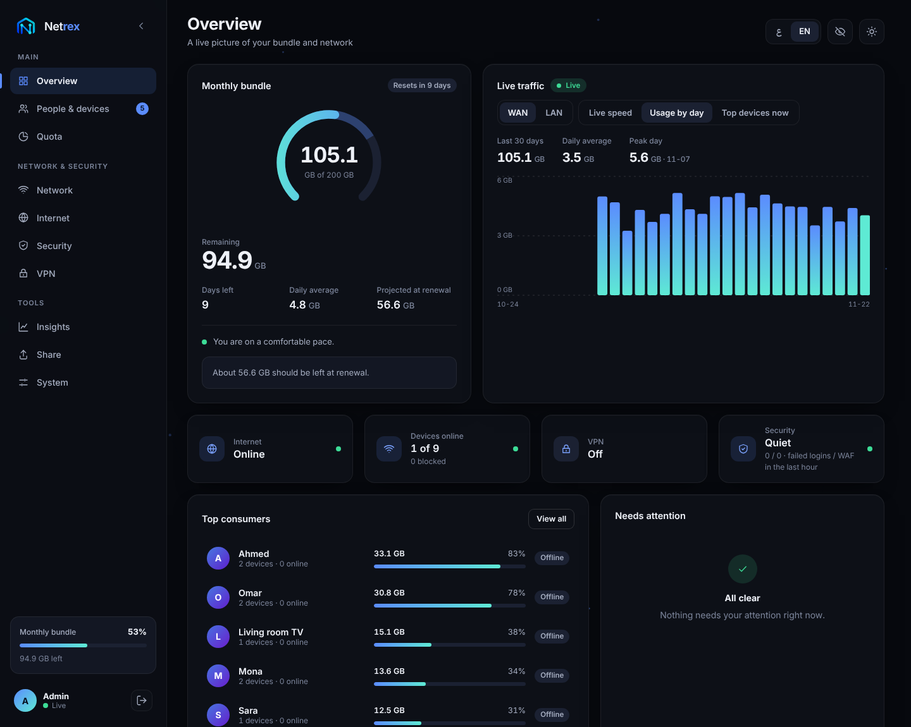
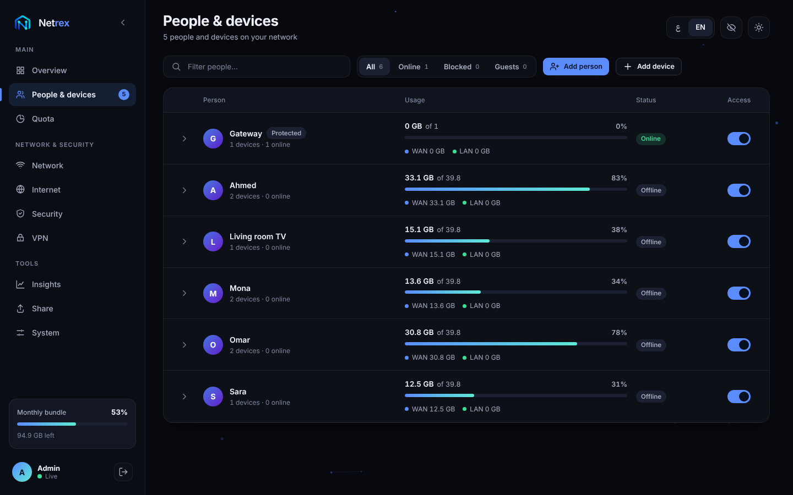
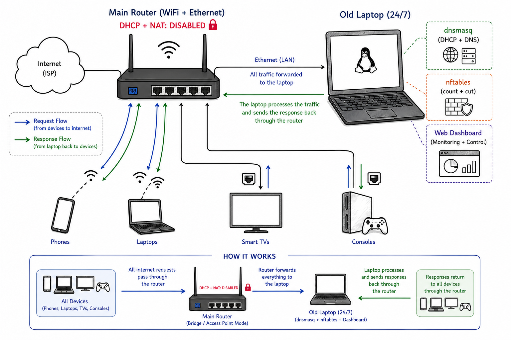

<p align="center">
  
</p>

<h1 align="center">Netrex for OpenWrt — MIPS Port</h1>

<p align="center">
  
  
</p>

<p align="center">
  <b>This is not the upstream project.</b> It is an unofficial port of <a href="https://github.com/UserJoo9/Netrex"><b>Netrex</b></a> that runs on OpenWrt routers with the <b>MIPS</b> architecture (<code>mips</code>, <code>mipsel</code>, soft- and hard-float).<br>
  Netrex was created by <a href="https://github.com/UserJoo9"><b>Youssef (@UserJoo9)</b></a> — all credit for the original project is his. This repository only adds OpenWrt/MIPS support. MIT licence, as upstream.
</p>

<p align="center">
  <b>The open-source home gateway that shares one limited internet bundle fairly — per person, across every device they own.</b><br>
  Live usage, hard quotas, speed control, ad blocking, VPN and remote access, in one dashboard. English & Arabic.
</p>

> [!WARNING]
> **Unofficial OpenWrt/MIPS port.** For routers, not PCs. Install with the router installer below; upstream support and bug reports about OpenWrt/MIPS belong in this repository, everything else upstream.

<p align="center">
  <a href="https://github.com/UserJoo9/Netrex/releases/latest"></a>
  <a href="https://github.com/UserJoo9/Netrex/actions/workflows/ci.yml"></a>
  <a href="https://github.com/UserJoo9/Netrex/stargazers"></a>
  <a href="LICENSE"></a>
</p>

<p align="center">
  
</p>

<p align="center">
  <a href="#install"><b>Install</b></a> ·
  <a href="#first-setup"><b>First setup</b></a> ·
  <a href="#using-it"><b>Features</b></a> ·
  <a href="#troubleshooting"><b>Help</b></a> ·
  <a href="Structure_README.md"><b>Developer guide</b></a> ·
  <a href="README_AR.md"><b>العربية</b></a>
</p>

> [!NOTE]
> **Quota Manager is now Netrex.** Same project, same features, same settings — just a new name. Existing gateways update normally from the dashboard.

<p align="center">
  
</p>

<table>
  <tr>
    <td width="33%" valign="top"><b>📊 Fair by design</b><br>Every person gets a fixed GB or an equal share. All their devices draw from it, and only theirs stop when it runs out.</td>
    <td width="33%" valign="top"><b>⚡ Live, to the device</b><br>Who is using what right now, daily history, top sites, WAN and LAN traffic — counted in the Linux kernel.</td>
    <td width="33%" valign="top"><b>🛡️ Control the whole home</b><br>Speed limits, ad & content blocking, firewall, guest vouchers, VPN for chosen people, remote access with Tailscale.</td>
  </tr>
</table>

<p align="center">
  
</p>

---

## What it does

Every person gets a monthly allowance (a fixed number of GB, or an equal share of what's left). All of their devices share it. When it runs out, **their devices are cut off** — nobody else is affected.

- See who used how much, live, per person and per device
- Set speed limits and keep gaming ping low while others download
- Block, kick or pause any device in one tap
- Block ads and adult/gambling sites for the whole house
- Built-in VPN, firewall, file sharing between devices, and remote access from anywhere (Tailscale)
- Works in **English and Arabic**, light and dark, on phone and desktop

## How it works

A small always-on computer sits between your router and your devices. Your router keeps WiFi; this computer hands out the addresses and counts the traffic.

<p align="center">
  
</p>

---

## Install

Netrex runs **on the router itself**. This port supports one installation target only: an **OpenWrt** router on the **MIPS** architecture (`mips`, `mipsel`, soft-float and hard-float). There is no PC, virtual machine, Raspberry Pi, Android or apt/rpm/pacman install path — those belong to the [upstream project](https://github.com/UserJoo9/Netrex).

You need OpenWrt 22.03+ with 128 MB+ RAM (on small-flash routers, use a USB drive with ExtRoot). OpenWrt 25.12 replaced `opkg` with `apk`; the installer detects which one your router has (22.03-24.10 use `opkg`).

### One command

Run this in the router's root shell (OpenWrt has no `sudo`):

```bash
wget -qO- https://raw.githubusercontent.com/joyusufx/Netrex-OpenWRT/openwrt-mips-port/scripts/get.sh | sh
```

It hands off to the router installer, which installs the dependencies (python3, pip, nftables, kmod-nft-core, kmod-tun, kmod-ifb, tc, ip-full, dnsmasq-full, git-http, ca-bundle, python3-yaml, python3-websockets, conntrack), clones the code into `/opt/quota-manager`, installs the Python deps with `pip --target`, writes `/etc/quota-gateway/config.yaml` if it is missing, and registers and starts the procd service `/etc/init.d/quota-manager`.

### Or the installer directly

```bash
wget -O /tmp/install_openwrt.sh https://raw.githubusercontent.com/joyusufx/Netrex-OpenWRT/openwrt-mips-port/scripts/install_openwrt.sh
sh /tmp/install_openwrt.sh
```

Installing from a fork or another branch: put `NETREX_REPO=OWNER/NAME` and `NETREX_REF=branch` in front of `sh` (for example `... | NETREX_REPO=you/Netrex-OpenWRT NETREX_REF=main sh`).

> Support is **experimental**: MIPS and MIPS little-endian routers are supported — the gateway picks the right ready-made binary for your router's exact chip and float ABI automatically, with soft-float as the safe fallback. Passkeys are not available on a router: sign in with password + TOTP. If it fails, open an issue with the full output. Details: [docs/OPENWRT.md](docs/OPENWRT.md).

---

## First setup

**1. Nothing to change on the router's DHCP.** Netrex runs on the router beside its own dnsmasq (the installer pulls in `dnsmasq-full`), so the router keeps handing out addresses; there is no second box and no DHCP to turn off. Keep the router's Wi-Fi and NAT on.

**2. Open the dashboard** from any device on the network:

```
http://<router-ip>:8080
```

`<router-ip>` is your router's LAN address, usually `192.168.1.1` — so `http://192.168.1.1:8080`.

Password: **`admin`** — you'll be asked to change it right away.

**3. Fill in the welcome screen:** your bundle size (e.g. `140` GB) and the day your provider renews it.

**4. Give people allowances.** New devices appear on their own, but start **disabled** (0 GB) as a safety lock. Add a person, assign the device to them, and set their share.

> Can't open the dashboard? Check the service on the router: `/etc/init.d/quota-manager status`, then `logread -e netrex` for why it stopped. A device that still has an old address needs to reconnect to Wi-Fi.

---

## Reach the dashboard from outside your home

Many internet lines block or drop connections coming from outside, so opening a port on your public IP often does not work. Use the built-in **Tailscale** instead: **Internet → Remote access → Install**, sign in once, then install the Tailscale app on your phone with the same account and open the address shown on that card. Nothing is opened on your public IP, so keep the "Allow dashboard access from the internet" switch off.

---

## Using it

| Page | What you do there |
|---|---|
| **Overview** | Remaining bundle, days left, live speed and who is using it right now |
| **People & devices** | Add people, move devices, top up GB, speed limits, block or kick |
| **Quota** | Bundle size, renewal day, top-up packs, optional daily quota switch |
| **Network** | Guest mode, new-device rules, IP reservations, allow / block lists |
| **Internet** | Line status, public IP, direct PPPoE mode, remote access with Tailscale |
| **Security** | Firewall, ad & content blocking, HTTPS |
| **VPN** | Add servers, choose who goes through the VPN |
| **Insights** | Daily usage, top devices, most visited domains |
| **Share** | Send files and folders between devices, even straight to a nearby device; share a hard disk with every device |
| **System** | Language, light/dark, colour themes, password and 2FA, updates, logs; restart, factory reset, turn off |

Handy to know:

- **Top up** a person mid-month from their card — they're back online instantly.
- **Eye icon** hides names and MAC addresses, handy before showing your screen.
- **Daily quota (optional):** switch it on in **Quota**, then open a person's card → **Daily plan**. Choose *fixed GB per day* or *split what is left of the month over the days left*, what happens to unused GB (next day or spread), heavier days, and how the person's devices share the day. The monthly quota still applies; at the daily limit the devices pause until midnight. The person sees today's plan on their usage page.
- **My usage page:** any device can open `http://<router-ip>:8080/milestone` (no login) to see its own remaining allowance.
- The dashboard opens at the same address as always (`http://<router-ip>:8080/`). Old bookmarks to `/ui/` forward there automatically.
- **WAN | LAN switch** above the Overview chart: the same live speed, daily usage and top devices, for the internet or for traffic inside your home (NAS, router, the gateway itself).
- **Guest vouchers:** in **Network** → *Guest vouchers*, create a one-time code with a GB allowance (and an optional expiry or note). A guest waiting on the portal page types the code and gets that allowance right away, without you approving them by hand. Each code works once; unused codes can be revoked from the same list. Waiting guests show as *Pending approval* in People & devices.
- **Sharing**: drop files or folders on the Share page, or send them straight to another device on the WiFi (up to 50 MB; several files or folders arrive as one ZIP).
- **Internet schedule** (new page): turn the internet off at set times for chosen people or devices, e.g. *School nights* 23:00-07:00 Sunday to Thursday. Start from a ready plan or set your own times (a time can run past midnight), mark holidays as days off, give **bonus time** (+15/+30/+60 min) without editing, and list sites that stay **always allowed** (school platform, study sites). The device's card shows when its internet comes back; the home network keeps working. The gateway frees each device at its end time on its own, even if the service restarts. Always-allowed sites only open on devices that use the gateway for DNS (turn off Private DNS / secure DNS on that device).
- **Network drives** (Share page): plug a hard disk into the router and press *Share*, or add a folder another PC or the router already shares (`//192.168.1.5/Movies`). Devices open it at `\\<router-ip>\<name>` (Windows) or `smb://<router-ip>/<name>`, no password. **Access** on each share picks who gets in (every device with internet, or only the devices you choose) and gives any device read-write, read-only or no access; cut-off devices never get in. Shares are reachable from the home network only. The first time, the page offers to install Samba. Shares come back on their own after a reboot or when the disk is plugged back in.
- **Restart / factory reset / turn off** (System → Power): restart the gateway or the whole machine; factory reset puts the settings back to how a fresh install starts without reinstalling (tick *keep people and devices* to keep people, devices, the bundle, this month's usage and your password; the line mode and PPPoE login always stay, and the database is backed up to `/var/lib/quota-gateway/backups/` first); turn off stops the gateway and keeps it off after a reboot (to start it again: `/etc/init.d/quota-manager enable && /etc/init.d/quota-manager start`).
- Risky buttons (kick, blacklist, enable HTTPS, remove an allow/block entry, clear all) ask you to **tap twice** — the second tap confirms.

---

## Update & remove

The dashboard checks for updates itself (**System → Updates**) and can install them in one click. Your settings and data are kept.

```bash
sh /tmp/install_openwrt.sh --upgrade          # update: re-download the installer and run it with --upgrade
/etc/init.d/quota-manager disable             # stop it and keep it off after a reboot
rm -rf /opt/quota-manager /etc/init.d/quota-manager   # remove the program (data stays)
```

Your data lives in `/var/lib/quota-gateway/quota.db` and survives removal. To back it up (safe while the gateway is running):

```bash
python3 -c "import sqlite3; sqlite3.connect('/var/lib/quota-gateway/quota.db').backup(sqlite3.connect('/root/netrex-backup.db'))"
```

Don't just copy `quota.db` with `cp` while the gateway runs: recent changes may still sit in a side file and the copy can come out broken. Restoring a backup is in the [backup and restore guide](Structure_README.md#sqlite-backup-and-restore).

## Troubleshooting

| Problem | Fix |
|---|---|
| No internet after setup | Check the service is running (`/etc/init.d/quota-manager status`) and that the router still hands out addresses |
| Device has internet but isn't counted | Turn off IPv6 / Router Advertisement on the router |
| A computer has no internet and shows under *Unmanaged devices* | It uses a **manually typed IP**. Set it to obtain an IP **automatically (DHCP)**; to keep one fixed address, reserve it for that device in the dashboard instead |
| Installer stops: neither `apk` nor `opkg` found | Make sure you are on OpenWrt 22.03+ (`cat /etc/openwrt_release`) |
| Everything stopped after a reboot | `/etc/init.d/quota-manager enable && /etc/init.d/quota-manager start` |
| Forgot the password | Ask in an issue, or see the developer guide below |
| Speed limits do nothing | Network page → turn shaping on and enter your real line speed |

## Good to know

- Usage is counted every ~15 seconds, so numbers are approximate.
- Over-limit users are fully cut off, not slowed.
- If the gateway loses power, the home network loses internet.
- Deleting a device blocks it for good until you remove it from the block list.
- One admin session at a time: signing in on another device signs the first one out, and changing the password signs out everywhere.
- In **LAN** mode, firewall rules whose source is your home network have no effect (home devices are always allowed); use blocks or switch to **WAN** mode to restrict them.

---

**Developers:** see [Structure_README.md](Structure_README.md) · **License:** [MIT](LICENSE) · Not affiliated with any ISP.
