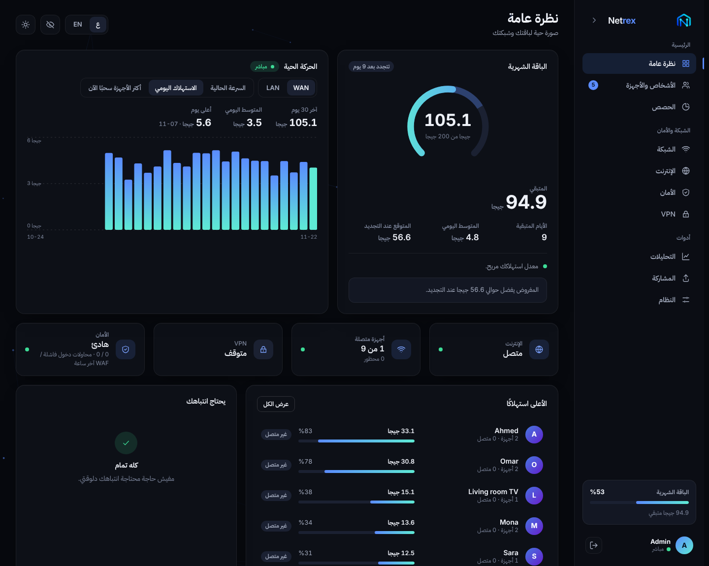
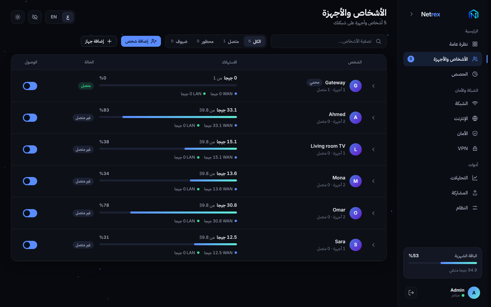
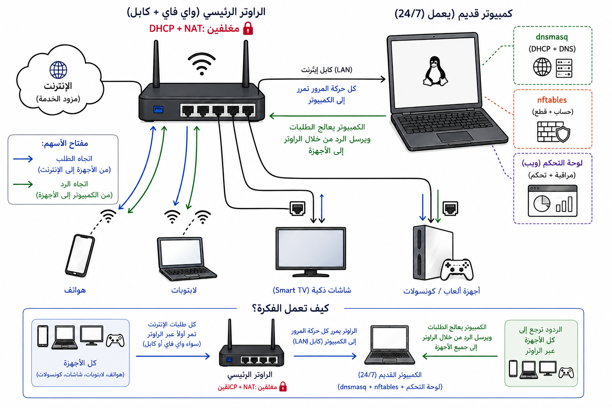

<p align="center">
  
</p>

<h1 align="center" dir="rtl">Netrex لراوترات OpenWrt — نسخة MIPS</h1>

<p align="center">
  
  
</p>

<p align="center" dir="rtl">
  <b>ده مش المشروع الأصلي.</b> ده بورت غير رسمي لمشروع <a href="https://github.com/UserJoo9/Netrex"><b>Netrex</b></a> بيشتغل على راوترات OpenWrt بمعمارية <b>MIPS</b> (mips و mipsel، soft-float و hard-float).<br>
  صاحب Netrex الأصلي هو <a href="https://github.com/UserJoo9"><b>يوسف (@UserJoo9)</b></a> — وكل الفضل في المشروع الأصلي ليه. المستودع ده بيضيف بس دعم OpenWrt/MIPS. الرخصة MIT زي الأصل.
</p>

<div dir="rtl">

<p align="center">
  <b>بوابة منزلية مفتوحة المصدر بتوزّع باقة الإنترنت المحدودة بعدل — لكل شخص، على كل أجهزته.</b><br>
  استهلاك لحظي، وحصص بتتنفّذ فعلًا، وتحكم في السرعة، وحجب إعلانات، وVPN ووصول من برّه البيت، في لوحة واحدة. بالعربي والإنجليزي.
</p>

> [!WARNING]
> **نسخة غير رسمية لـ OpenWrt/MIPS.** دي للراوترات مش للكمبيوتر. التثبيت بمثبّت الراوتر اللي تحت؛ مشاكل OpenWrt/MIPS بتتسجّل هنا، وأي حاجة تانية في المستودع الأصلي.

</div>

<p align="center">
  <a href="https://github.com/UserJoo9/Netrex/releases/latest"></a>
  <a href="https://github.com/UserJoo9/Netrex/actions/workflows/ci.yml"></a>
  <a href="https://github.com/UserJoo9/Netrex/stargazers"></a>
  <a href="LICENSE"></a>
</p>

<p align="center">
  
</p>

<p align="center" dir="rtl">
  <a href="#التثبيت"><b>التثبيت</b></a> ·
  <a href="#الإعداد-الأول"><b>الإعداد الأول</b></a> ·
  <a href="#الاستخدام"><b>المميزات</b></a> ·
  <a href="#حل-المشاكل"><b>المساعدة</b></a> ·
  <a href="Structure_README.md"><b>دليل المطوّرين</b></a> ·
  <a href="README.md"><b>English</b></a>
</p>

<div dir="rtl">

> [!NOTE]
> **Quota Manager بقى اسمه Netrex.** نفس المشروع ونفس المميزات ونفس الإعدادات، الاسم بس اللي اتغيّر. الأجهزة المتثبّت عليها البرنامج بتتحدّث عادي من اللوحة.

</div>

<p align="center">
  
</p>

<table dir="rtl">
  <tr>
    <td width="33%" valign="top"><b>📊 عادل من الأساس</b><br>كل شخص بياخد عدد جيجا ثابت أو نصيب متساوي. كل أجهزته بتسحب منه، ولما يخلص أجهزته هو بس اللي بتقف.</td>
    <td width="33%" valign="top"><b>⚡ لحظي ولحد الجهاز</b><br>مين بيستخدم إيه دلوقتي، وتاريخ يومي، وأكتر المواقع، وحركة الإنترنت والشبكة الداخلية — متعدّة من نواة لينكس نفسها.</td>
    <td width="33%" valign="top"><b>🛡️ تحكم في البيت كله</b><br>تحديد سرعات، وحجب إعلانات ومحتوى، وجدار حماية، وقسائم ضيوف، وVPN لأشخاص بعينهم، ووصول من برّه بـ Tailscale.</td>
  </tr>
</table>

<p align="center">
  
</p>

<div dir="rtl">

---

## بيعمل إيه

كل شخص بياخد حصة شهرية (عدد جيجابايت ثابت، أو نصيب متساوي من المتبقي)، وكل أجهزته بتتشارك فيها. لما الحصة تخلص **أجهزته هو بس بتتفصل** — وباقي البيت مش بيتأثر.

- تشوف مين استهلك كام، لحظة بلحظة، لكل شخص ولكل جهاز
- تحدد سرعة أي جهاز وتحافظ على بينج الألعاب واطي وغيرك بيحمّل
- تحظر أو تفصل أو توقف أي جهاز بضغطة
- تحجب الإعلانات والمواقع الإباحية والقمار على البيت كله
- فيه VPN وفايروول ومشاركة ملفات ودخول للوحة من أي مكان (Tailscale)
- بالعربي والإنجليزي، فاتح وغامق، على الموبايل والكمبيوتر

## إزاي بيشتغل

جهاز صغير شغال طول الوقت بيتحط بين الراوتر وأجهزتك. الراوتر بيفضل بيبث الواي فاي، والجهاز ده بيدّي العناوين ويعدّ الاستهلاك.

<p align="center">
  
</p>

---

## التثبيت

النسخة دي لراوترات **OpenWrt بمعمارية MIPS** (`mips` و`mipsel`، soft-float وhard-float). طرق التثبيت للكمبيوتر وRaspberry Pi والآلات الافتراضية وأندرويد موجودة في [المشروع الأصلي](https://github.com/UserJoo9/Netrex)، مش هنا.

### أمر واحد

نفّذ الأمر ده في root shell على الراوتر، من غير `sudo`:

</div>

```bash
wget -qO- https://raw.githubusercontent.com/joyusufx/Netrex-OpenWRT/openwrt-mips-port/scripts/get.sh | NETREX_REPO=joyusufx/Netrex-OpenWRT NETREX_REF=openwrt-mips-port sh
```

<div dir="rtl">

لو بتنصّب من fork أو من branch: حط `NETREX_REPO=OWNER/NAME` و`NETREX_REF=branch` قبل `sh`.

### أو مثبّت الراوتر مباشرة

OpenWrt 22.03+ وذاكرة 128MB أو أكتر (في الراوترات الصغيرة استخدم فلاشة USB بـ ExtRoot).

</div>

```bash
wget -O /tmp/install_openwrt.sh https://raw.githubusercontent.com/joyusufx/Netrex-OpenWRT/openwrt-mips-port/scripts/install_openwrt.sh
sh /tmp/install_openwrt.sh
```

<div dir="rtl">

> OpenWrt 25.12 استبدل `opkg` بـ `apk`، والسكربت ده بيكتشف اللي عندك تلقائياً (22.03 لحد 24.10 بيستخدموا `opkg`). الدعم **تجريبي**: النسخة دي مخصّصة لراوترات MIPS و MIPS little-endian — البرنامج بيختار الملف الجاهز المناسب لنوع المعالج و float ABI تلقائياً (soft-float هو الافتراضي الآمن). الـ passkeys مش متاحة على الراوتر: سجّل الدخول بكلمة السر + TOTP. لو فشل افتح issue مع الـ output كامل. التفاصيل في docs/OPENWRT.md.

</div>

<div dir="rtl">

---

## الإعداد الأول

**1. مفيش حاجة تتغير في DHCP الراوتر.** Netrex بيشتغل على الراوتر جنب الـ dnsmasq بتاعه (المثبّت بينزّل `dnsmasq-full`)، فالراوتر بيفضل يوزّع العناوين زي ما هو — مفيش جهاز تاني ومفيش DHCP يتقفل. سيب الواي فاي وNAT شغالين.

**2. افتح لوحة التحكم** من أي جهاز على الشبكة:

</div>

```
http://<راوتر-ip>:8080
```

<div dir="rtl">

يعني غالباً `http://192.168.1.1:8080` — عنوان الراوتر على شبكة البيت.

كلمة السر: **`admin`** — هيطلب منك تغييرها على طول.

**3. املا شاشة الترحيب:** حجم الباقة (مثلًا `140` جيجا) واليوم اللي المزود بيجدد فيه.

**4. وزّع الحصص.** الأجهزة الجديدة بتظهر لوحدها لكن بتبدأ **مقفولة** (0 جيجا) كقفل أمان. ضيف شخص، اربط الجهاز بيه، وحدد نصيبه.

> مش قادر تفتح اللوحة؟ اتأكد من الخدمة على الراوتر: `/etc/init.d/quota-manager status` وبعدين `logread -e netrex` عشان تعرف وقفت ليه. وأي جهاز لسه معاه عنوان قديم محتاج يعيد الاتصال بالواي فاي.

---

## الدخول للوحة من برّه البيت

خطوط إنترنت كتير بتقفل أو بتبوّظ الاتصالات اللي جاية من بره، فلو فتحت بورت على الـ IP العام ساعات مش بيشتغل. استخدم **Tailscale** المدمج بدل كده: **الإنترنت ← الدخول من بعيد ← ثبّت**، سجّل دخول مرة واحدة، وبعدها نزّل تطبيق Tailscale على موبايلك بنفس الحساب وافتح العنوان اللي ظاهر في الكارت. مفيش أي حاجة بتتفتح على الـ IP العام، فسيب مفتاح "السماح بالدخول للوحة من الإنترنت" مقفول.

---

## الاستخدام

| الصفحة | بتعمل فيها إيه |
|---|---|
| **نظرة عامة** | المتبقي من الباقة، الأيام الباقية، السرعة اللحظية ومين بيستهلك دلوقتي |
| **الناس والأجهزة** | إضافة أشخاص، نقل أجهزة، شحن جيجا، حدود السرعة، حظر أو فصل |
| **الحصة** | حجم الباقة، يوم التجديد، باقات الشحن |
| **الشبكة** | وضع الضيف، قواعد الأجهزة الجديدة، حجز العناوين، قوائم السماح والحظر |
| **الإنترنت** | حالة الخط، الـ IP العام، وضع PPPoE المباشر، الدخول من بعيد بـ Tailscale |
| **الأمان** | الفايروول، حجب الإعلانات والمحتوى، HTTPS |
| **VPN** | إضافة سيرفرات واختيار مين يعدّي من الـ VPN |
| **التحليلات** | الاستهلاك اليومي، أكتر الأجهزة، أكتر المواقع زيارة |
| **المشاركة** | ابعت ملفات وفولدرات بين الأجهزة، حتى مباشرة لجهاز قريب، وشارك هارد مع كل الأجهزة |
| **النظام** | اللغة، فاتح/غامق، ثيمات الألوان، كلمة السر و2FA، التحديثات، السجلات، إعادة التشغيل وضبط المصنع والإيقاف |

حاجات مفيدة:

- **اشحن** لأي شخص في نص الشهر من كارته — بيرجع أونلاين فورًا.
- **أيقونة العين** بتخفي الأسماء وعناوين MAC، مفيدة قبل ما تعرض شاشتك.
- **الحصة اليومية (اختيارية):** فعّلها من صفحة **الباقة**، وبعدها افتح كارت أي شخص ← **الخطة اليومية**. اختار *جيجا ثابتة كل يوم* أو *تقسيم الباقي من الشهر على الأيام اللي فاضلة*، والباقي من اليوم يترحّل لبكرة ولا يتوزع، وأيام استهلاك أعلى، وإزاي أجهزة الشخص تتقاسم اليوم. الحصة الشهرية لسه سارية، وعند الحد اليومي الأجهزة بتقف لحد 12 بليل. والشخص يشوف خطة النهارده في صفحة استهلاكه.
- **صفحة استهلاكي:** أي جهاز يفتح `http://<راوتر-ip>:8080/milestone` (من غير دخول) يشوف الباقي من حصته.
- اللوحة بتفتح على نفس العنوان زي الأول (`http://<البوابة>:8080/`)، واللينكات القديمة `/ui/` بتتحوّل لوحدها.
- **زرار WAN | LAN** فوق رسم النظرة العامة: نفس السرعة اللحظية والاستهلاك اليومي وأعلى الأجهزة، للإنترنت أو للترافيك جوه البيت (NAS، الراوتر، البوابة نفسها).
- **قسائم الضيوف:** من **الشبكة** ← *قسائم الضيوف*، اعمل كود لمرة واحدة بحصة بالجيجا (ومعاه تاريخ انتهاء أو ملاحظة لو حبيت). الضيف المستني في صفحة الانتظار بيكتب الكود ويأخد الحصة فورًا من غير ما توافق عليه بإيدك. كل كود بيشتغل مرة واحدة، والأكواد اللي ما اتستخدمتش تقدر تلغيها من نفس القايمة. الضيوف المستنيين بيظهروا *بانتظار الموافقة* في الناس والأجهزة.
- **المشاركة**: اسحب ملفات أو فولدرات في صفحة المشاركة، أو ابعتها مباشرة لجهاز تاني على الواي فاي (لحد 50 ميجا؛ لو أكتر من ملف أو فولدر بتوصل ZIP واحد).
- **مواعيد الإنترنت** (صفحة جديدة): اقفل الإنترنت في أوقات محددة لأشخاص أو أجهزة معينة، زي *ليالي الدراسة* من 11 بالليل لـ 7 الصبح من الحد للخميس. ابدأ من خطة جاهزة أو حدد مواعيدك بنفسك (الوقت ممكن يعدّي نص الليل)، وحدد أيام الإجازات، وادي **وقت إضافي** (+15 أو +30 أو +60 دقيقة) من غير ما تعدّل الجدول، واكتب المواقع اللي تفضل **مسموحة دايماً** (منصة المدرسة، مواقع المذاكرة). كارت الجهاز بيبين النت هيرجع إمتى، والشبكة الداخلية بتفضل شغالة. البوابة بترجّع النت لكل جهاز في ميعاده لوحدها حتى لو الخدمة عملت ريستارت. المواقع المسموحة بتفتح بس على الأجهزة اللي بتستخدم DNS البوابة (اقفل Private DNS أو الـ DNS الآمن على الجهاز).
- **أقراص على الشبكة** (صفحة المشاركة): وصّل هارد بالراوتر ودوس *مشاركة*، أو ضيف فولدر متشارك على كمبيوتر تاني أو على الراوتر (`//192.168.1.5/Movies`). الأجهزة تفتحه على `\\<راوتر-ip>\<الاسم>` (ويندوز) أو `smb://<راوتر-ip>/<الاسم>` من غير باسورد. من زرار **الصلاحيات** في كل مشاركة تختار مين يدخل (كل الأجهزة اللي عندها نت، أو أجهزة إنت تختارها)، وتدي أي جهاز قراءة وكتابة أو قراءة بس أو تمنعه. الأجهزة المقطوع عنها النت عمرها ما بتدخل، والمشاركة بتشتغل على شبكة البيت بس. أول مرة الصفحة هتعرض تثبيت Samba. المشاركات بترجع لوحدها بعد الريستارت أو لما الهارد يتركّب تاني.
- **إعادة التشغيل وضبط المصنع والإيقاف** (النظام ← التشغيل): أعد تشغيل البوابة أو الجهاز كله. ضبط المصنع بيرجّع الإعدادات زي أول تثبيت من غير ما تمسح البرنامج (علّم *احتفظ بالأشخاص والأجهزة* علشان الأشخاص والأجهزة والباقة واستهلاك الشهر والباسورد يفضلوا؛ وضع الخط وبيانات PPPoE بيفضلوا دايمًا، وبتتعمل نسخة احتياطية من قاعدة البيانات في `/var/lib/quota-gateway/backups/` الأول). الإيقاف بيقفل البوابة وتفضل مقفولة بعد الريستارت (علشان تشغّلها تاني: `/etc/init.d/quota-manager enable && /etc/init.d/quota-manager start`).
- الأزرار الخطيرة (طرد، بلاك ليست، تفعيل HTTPS، حذف عنصر من قايمة سماح/حظر، مسح الكل) **بتتطلب ضغطتين** — التانية هي التأكيد.

---

## التحديث والإزالة

اللوحة بتفحص التحديثات لوحدها (**النظام ← التحديثات**) وتقدر تثبّتها بضغطة. إعداداتك وبياناتك بتفضل زي ما هي.

من root shell على الراوتر:

</div>

```bash
sh /tmp/install_openwrt.sh --upgrade            # تحديث: أعد تنزيل المثبّت وشغّله بـ --upgrade
/etc/init.d/quota-manager disable               # وقّف الخدمة ومنعها من التشغيل بعد الريستارت
rm -rf /opt/quota-manager /etc/init.d/quota-manager   # إزالة البرنامج (البيانات بتفضل)
```

<div dir="rtl">

بياناتك موجودة في `/var/lib/quota-gateway/quota.db` وبتفضل بعد الإزالة.

</div>

```bash
python3 -c "import sqlite3; sqlite3.connect('/var/lib/quota-gateway/quota.db').backup(sqlite3.connect('/root/netrex-backup.db'))"
```

<div dir="rtl">

ما تنسخش `quota.db` بـ `cp` والبوابة شغالة: آخر التغييرات ممكن تكون لسه في ملف جانبي والنسخة تطلع بايظة. استرجاع النسخة موجود في [دليل النسخ والاسترجاع](Structure_README.md#sqlite-backup-and-restore).

## حل المشاكل

| المشكلة | الحل |
|---|---|
| مفيش إنترنت بعد الإعداد | اتأكد إن الخدمة شغالة (`/etc/init.d/quota-manager status`) وإن الراوتر لسه بيوزّع عناوين |
| الجهاز عليه إنترنت بس مش بيتحسب | اقفل IPv6 / Router Advertisement في الراوتر |
| كمبيوتر مفيش عليه إنترنت وظاهر في *أجهزة غير مُدارة* | بيستخدم **IP مكتوب يدوي**. خلّيه ياخد IP **أوتوماتيك (DHCP)**؛ ولو عايزه ثابت احجز له العنوان من اللوحة بدل ما تكتبه على الجهاز |
| شغّال في VM: الأجهزة بتتوصل بس مفيش إنترنت والعدّادات صفر | النسخة دي للراوتر نفسه بس؛ لو شغّال في VM دي طريقة تثبيت مش مدعومة هنا — استخدم [المشروع الأصلي](https://github.com/UserJoo9/Netrex) |
| المثبّت بيوقف ومش لاقي `apk` ولا `opkg` | تأكد إنك على OpenWrt 22.03+ (`cat /etc/openwrt_release`) |
| كله وقف بعد إعادة التشغيل | `/etc/init.d/quota-manager enable && /etc/init.d/quota-manager start` |
| نسيت كلمة السر | افتح issue، أو شوف دليل المطورين تحت |
| حدود السرعة مش بتشتغل | صفحة الشبكة ← شغّل التحكم في السرعة وادخل سرعة خطك الحقيقية |

## ملاحظات

- الاستهلاك بيتقرأ كل ~15 ثانية، فالأرقام تقريبية.
- اللي بيعدّي حصته بيتفصل تمامًا، مش بيتبطّأ.
- لو البوابة فصلت كهربا، البيت يفقد الإنترنت.
- حذف جهاز بيحظره نهائيًا لحد ما تشيله من قائمة الحظر.
- جلسة أدمن واحدة في الوقت: لو دخلت من جهاز تاني الأول بيتسجل خروجه، وتغيير كلمة السر بيخرّجك من كل مكان.
- في وضع **LAN** قواعد الفايروول اللي مصدرها شبكة البيت مبتأثرش (أجهزة البيت دايمًا مسموحة)؛ استخدم الحظر أو غيّر لوضع **WAN** لو عايز تقيّدها.

---

**للمطورين:** [Structure_README.md](Structure_README.md) · **الرخصة:** [MIT](LICENSE) · غير تابع لأي مزود إنترنت.

</div>
